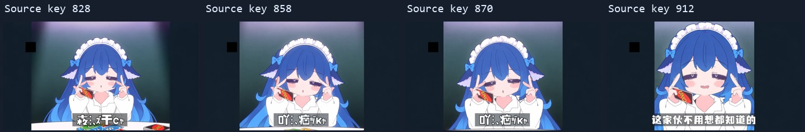
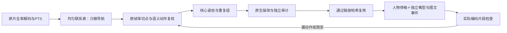

# UNO → DS娘：动作关键帧描改工程

把手书 MV 的角色改成 DS娘，保留原镜头的动作、表情、服装、手牌接触和构图。这个仓库公开实际采用的抽帧口径、一致性约束、修订记录、提示词及可重放的合成代码。

**核心做法是保留动作切换的关键原画，省去连接姿态；重复姿态复用同一份通过稿。** 不是把视频均匀降到 4 fps，也不是让模型独立重画每一帧。

[下载工作素材](https://github.com/InariNGT-Ofiicial/uno-ds-reconstruction/releases/tag/v1.0.0) · [抽帧方法](docs/frame-selection.md) · [一致性约束](docs/consistency.md) · [复现](docs/reproduction.md) · [失败与修订](docs/decisions-and-failures.md)

**高清导出**：从941像素高原画直接重新合成1440p，移除了先降到480p的细节瓶颈。[高清渲染说明与对比](docs/high-resolution.md)。成片只在本机交付；GitHub仅保留代码、说明和工作素材，不托管视频。

高清发布件：123,545,778字节，SHA256 `5608ae57d3d9d1c74c54bd3941f80dd6158b59caadf69fa7f029d972402244c7`。完整顺序解码5245帧，音画均为218.541667秒；所有帧的动作与图文采用记录与v1.0一致。



四份稿不是每秒四张的网格：倾头相位会返回已用稿，字幕与嘴形另按源事件安排。

## 这个版本实际做到了什么

| 项目 | 实际值与含义 |
|---|---|
| 原片时间坐标 | 24 fps，5245 帧，218.541667 秒，852 × 480 |
| v1.0成片 | 1280 × 720，24 fps 容器，保留原音轨内容 |
| v1.1高清成片 | 2560 × 1440，24 fps，CRF 14；原画直接采样，保持相同动作与事件时间线 |
| 最终时间线 | 176 个连续区间，包含人物停格、图形、转场和安全原片区间；不是176个独立姿态 |
| 实际使用的完整画面文件 | 83 份，含净版及表情变体；不是83次生图 |
| 内置生图实际调用 | 130 次，含退稿、修稿、透明部件和文字修改 |
| 返回凭据 | 本地对130次原始返回与项目副本逐字节核验；公开脱敏后的提示词与哈希 |
| 最终合成输入 | 本地核对722个实际读取文件，编码后无输入变化 |
| 验收范围 | 完整顺序解码5245帧＋实际选定画面检查；不宣称全片逐帧人工审美验收 |

v1.0成片 SHA256：`f1cef48edf3277b3ec57ec0dd637d0db8bce1ab45000728de691dae7f1decfb0`。这些数字描述当前项目，不是通用模型评测或质量分数。

v1.0发布前已从独立公开目录重新导入源输入、建立缓存、编译时间线并完整编码5245帧，输出与原交付逐字节相同。验证条件和范围见[复现记录](evidence/publication-validation.json)。v1.1高清版的独立验证见[高清记录](evidence/hd-render-validation.json)。

## 抽帧：先找到动作，再决定画几张

1. 顺序解码原片，保存帧号、PTS、time base、像素哈希和低分辨率变化量，固定时间坐标。
2. 先看2秒与0.25秒联系表，定位镜头和动作家族。这些网格只用于导航，不直接决定生产帧。
3. 回到原帧率检查切点前后，保留新手势、持牌手交换、方向反转、动作极点、落定，以及持续的表情变化。
4. 对省略的连接姿态，保持上一核心稿；对重复姿态，复用同一文件和 SHA256。嘴型、字幕、气泡、叹气字效与遮挡各有自己的事件时刻。
5. 复查长停格和所有“可以省略”的别名。**同一屏幕侧、相同头朝向，并不意味着手势相同。**

例如，33–38秒原先只保留一张 V 指稿，丢掉了倾头反转和嘴形变化。修订后用四张原生稿，按原片的真实动作相位安排重复曝光；102–106秒则补了无眼阴影、左右瞟眼和后续咬牙表情。选择过程与帧区间见[抽帧说明](docs/frame-selection.md)和[实际时间线](project/edit-plan.json)。



## 一致性：固定参考的职责，而不是只堆提示词

| 参考 | 可以决定 | 不可以决定 |
|---|---|---|
| 当前原 MV 全帧 | 姿态、脸型与表情、手指和牌、当前服装、构图与遮挡 | DS娘的发型设计 |
| 原始 DS娘立绘 | 身份、发色、鳍耳、发箍和蓝色 bow | 把立绘女仆服、尾巴、成人比例带入原镜头 |
| 冻结的 F005 发型母稿／完整 hair-only 板 | 主刘海、侧束、后发连接、主卷钩、头饰结构与色块 | 覆盖当前镜头的身体、脸和手牌 |
| 上一张已通过的相关稿 | 相邻投影关系与一致性检查 | 自动取代冻结母稿，或把上一次错误继续传播 |

发束约束写到具体结构：一片连续中央叶状主束、固定主分线、每侧连续脸侧束、连接的散发大面、约定的主卷钩，以及每侧一个鳍耳和 bow。正常角度变化可以改变投影；无理由增加 S 卷、环孔、分叉尖或改变束根连接要退回。

不同姿态由模型原生绘制；没有用液化、网格、非等比缩放、镜像或局部移动头手来制造动作。固定比例的整帧归一化是栅格对齐，不是姿态补间。**参考板上的蓝色选区只用于隔离参考职责，不是原初音头发的生产蒙版。**

我们先尝试传完整 F005，结果模型连它的脸和手牌位置一起借走了；后来换成保留整片后发连接、去掉身体信息的参考板。另一个重要规则是同姿态直接复用通过稿：重生一张“差不多相同”的图，通常不如复用原稿稳定。详见[一致性规范](docs/consistency.md)。

## 把人物与图文事件分开

人物稿不应为了字幕更新、嘴型切换或思考转圈而重复生成。本工程分别组织了人物、嘴型、字幕、气泡、前景扇牌、叹气文字、幕布、思考辐条和片尾图文。

这也暴露过真实合成错误：原片对白框在移动，采用的人物整稿却停格，直接贴原片坐标会让文字跑到气泡外；提取的紫色气泡还夹带过眼部转场的杂色条，以及被固定裁剪线截断的下缘。最终改为让白框文字适配当前气泡，并重建独立的紫色轮廓与白字。见[分层与合成](docs/compositing.md)。

## 复现入口

本仓库是 **Python／FFmpeg 的关键原画合成工程**，不是原作者的 AE 工程，也不包含后来独立开展的 AE 分层试验。

```bash
python -m venv .venv
# 激活虚拟环境后：
python -m pip install -r requirements.txt
python tools/install_assets.py --download
python tools/import_source.py --video /path/to/source-video.mp4 --audio /path/to/source-audio.m4s
python tools/catalog_source.py
python tools/build_plan.py
python tools/validate_project.py
python tools/render.py --label my-render --encode
```

FFmpeg 从 `FFMPEG_BINARY` 或 `PATH` 读取。原视频与原音轨不放进素材包，输入的 SHA256、尺寸和时长要求见[源输入清单](project/source-inputs.json)。同 BV 不同清晰度或编码版本不能自动视为同一输入。

固定资产可重放合成；**重新生图不保证逐像素重复**：内置工具没有暴露 seed 和每次调用的底层模型版本。公开提示词不是一个可脱离工具和参考图、自动跑出同样130张图的训练模型。完整步骤、环境记录、素材范围和验证见[复现说明](docs/reproduction.md)。

## 仓库内容

- `tools/`：顺序解码、联系表、动作时间线、合成、素材安装与校验。
- `project/`：当前通过稿清单、源时间坐标、图层事件和用户修订规则；大体积图片由 Release 素材包装入。
- `prompts/`、`evidence/`：130次调用记录、脱敏提示词、哈希及实际审计范围。
- `docs/`：抽帧口径、一致性设计、失败案例、图文分层与复现条件。

代码与本项目新写的说明采用 MIT。原曲、原 MV、角色立绘、派生图像和成片的相关权利不因代码开源而转移；素材范围与来源见 [NOTICE](NOTICE.md)。
