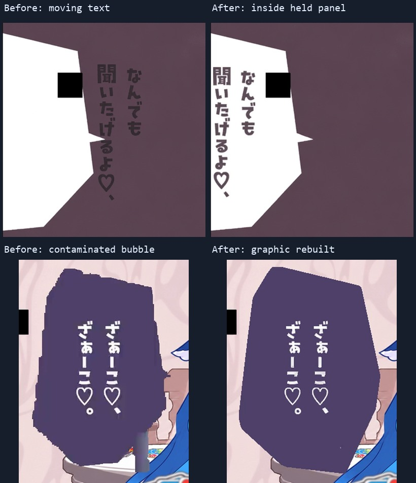

# 人物停格，图文仍按原时刻变化

本片的主要角色稿是完整画面，必要时另有净版和眼口变体，并不是每张都具有完整的头发、身体、衣服分层。真正独立组织的包括嘴型、字幕、气泡图文、前景扇牌、思考辐条、叹气字和幕布。

## 独立事件表

人物按 `project/edit-plan.json` 的区间取稿。嘴型和图形从自己的事件表取状态：

| 图层 | 当前数据 |
|---|---|
| 嘲讽口型 | `project/production/pair-a/mouth-events.json` |
| 源字幕、紫色气泡、前景牌与黄锣 | `project/source/source-graphics-manifest.json` |
| 思考转圈 | `project/source/revision-v2/thinking-effects/events.json`，113个源时刻 |
| 幕布与叹气字 | `project/source/revision-v2/overlay-events.json`，40个幕布与137个叹气事件 |
| 开场身份名牌 | `project/source/revision-v2/branding-events.json` |
| 尾卡 | `project/source/endcard/endcard-overlay-events.json` |

这些数是当前事件数量，不是需要重画的人物帧数。运行时先确定人物区间，再以同一源帧号查询图文与口型。

## 白色气泡文字为什么会跑出去

原 MV 的分格和对白框有横向位移；人物采用稿则按核心姿态停格。旧逻辑把当前原片的文字屏幕坐标直接贴在停格稿上，因此气泡仍在旧位置，字已经跟着原片跑到紫色背景。

修正后的 `source_white_paper` 分别找到当前源白框与采用稿白框，去掉独立黑方块对字界的干扰，取源文字组的边界，把文字等比适配到采用稿的文字槽里，并约束在白框内部。这样只移动排字，人物的头、手、衣服和框内位置都不变。

源墨色与文字抗锯齿另外估计，避免先把文字降成半透明、再用灰色墨色叠一次，导致对白变浅。检查对象包括镜头左右两种分格及后续困倦表情稿。

## 紫色气泡的裁切和杂色

两个具体问题不能只靠“没有绿色像素”发现：

1. 1:08附近的低位横向气泡延伸到画面下方，旧提取框固定截到 y410，把气泡下缘裁掉了。
2. 2:40附近，气泡图层夹带了源眼部转场的一段渐变杂色。即使绿色人物像素计数为零，它仍然是错误的图形内容。

最终 `source_purple_bubble` 在当前解码画面中读取独立平涂紫色区域，重建图形轮廓，再放入内部白字；底部中文字幕由独立层负责。没有把原人物彩色像素作为补丁贴回来。

对省略的眼部连接转场，若源气泡已被该转场切断，保留最后一个完整气泡图形直到明确清除，避免把“半个气泡”当作新的核心图形。

这里重建的是可用的独立平涂多边形与字形，不声称恢复了原作者逐点一致的 AE 路径。

## 其他层的经验

- 嘴型先清掉原嘴再放独立部件；左右朝向的部件原生绘制，没有运行时镜像嘴。
- 思考效果是12辐条的明暗轮转，不需要因此反复生成整张脸。几何和透明度是依据源画面的估计，非原作者工程曲线。
- 叹气字会发射、位移、缩小和淡出。若追踪器的最小尺度限制过大，尾字会提前消失；最终保留到2776，下一镜头2777明确清除。
- 幕布按源边界遮拢，底下保持已有倒立稿，2446明确全黑，避免提前整屏紫色或底图瞬闪。
- 黄锣在当前DS轮廓后面。曾经简单矩形遮挡产生横切边，后来按当前采用稿前景关系处理；这不是恢复初音发型蒙版来改人物。

图层问题要在实际合成和编码画面里查。人物单张通过，并不能证明字体坐标、口型、遮挡或清除事件正确。

上下两组分别对应白框文字错位和紫色图层杂边；这是实际编码画面的裁剪对照，不是新生成的效果示意图。
