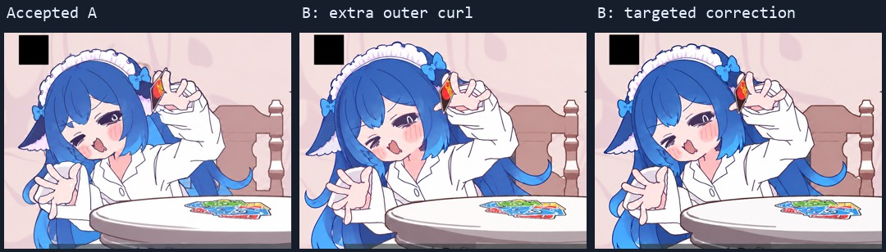

# 怎样约束一致性

一致性不能靠一句“保持角色一致”完成。本片把它拆成身份、发束结构、当前动作、相邻投影、素材复用和实际合成六个问题。

## 1. 把参考图职责写死

当前原 MV 全帧是动作、面部表情、白衬衫或原镜头服装、手牌接触和取景的唯一依据。DS娘原始立绘只提供发色、散发身份、鳍耳、发箍与 bow；不能连立绘服装、尾巴和成人身材一起移植。

冻结的 F005 是本片简化画法的发型母稿。后续生成图通过，不代表它自动成为新的母稿。上一通过稿用于相邻关系校验，不能把上一张图的错误继承成下一张规则。

素材包里的三个参考分别是：

- `project/references/ds-user-reference.png`：用户提供的原始身份依据；
- `project/references/frozen-f005.png`：本片冻结的简化画法；
- `project/references/f005-connected-hair-only.png`：保留整头后发连接的辅助板，不包含身体姿态权威。

完整 F005 一度让模型借走了脸、手、牌的位置。只截几个发梢碎片又丢失了整头连接关系。因此参考板保留完整的蓝发连接和轮廓，去掉脸、身体、手牌等容易污染动作的信息。板面布局、灰色空区、异位头饰局部和孤立小碎片都不能画进成品。

## 2. 约束“连接关系”，而不只是颜色

| 部位 | 固定内容 | 需要退回的变化 |
|---|---|---|
| 中央刘海 | 连续中央叶状主束、固定主分线与主尖端 | 改成锯齿碎尖、交叉分叉或突然钝方截断 |
| 脸侧束 | 每侧连续的一片主要长束，固定束根 | 一帧一尖、下一帧凭空多出两三束 |
| 后发 | 从头后连续披散的大面和约定主卷钩 | 新生外侧 S 圈、泪滴环孔、悬空卷丝 |
| 鳍耳 | 每边一个，深蓝外叶＋浅白内叶，固定连接 | 重复双耳、退回旧猫耳尖、变成飘散白三角 |
| 发箍与 bow | 简化褶边、约定比例、跟随头的固定根接 | 同一头角度下冠弧忽高忽低、bow换位置或设计 |
| 色块与线条 | 深蓝外发、亮蓝内束、大色块、统一简化程度 | 某一稿突然细密纹理、细碎高光和过多发丝 |

这是一套二维生产约束，不是假定我们建立了精确三维头发模型。转到背面、仰视或被牌遮住时，投影当然会变；检查的是变化有没有对应的角度或遮挡原因。

## 3. 保留原构图，不为角色设计改镜头

头饰被画框挡住就让它被挡住，不缩小、下移或重新居中人物。原片的黑色方块是固定图形，保留。不同镜头自带的女仆换装也保留，不强制一律白衬衫，更不直接搬入DS立绘的完整女仆服。

原角色是双马尾，DS娘是散发。沿初音的旧发型蒙版重绘会限制新后发空间，旧白描边也可能残留。早期蒙版路线被放弃，当前主要采用整帧原生编辑，并逐张检查非发区域有没有被改写。

## 4. 动作不同就新画，重复动作就精确复用

不同手势不能靠拉伸、镜像、旋转局部手臂或移动头部制造。当前工程没有液化、TPS、网格、剪切、非等比人物缩放或局部头手变换。

固定的栅格归一化例外需要说明：生成画面有1671或1672 × 941两种宽度，合成器用统一的高度比例与固定右边缘裁剪对齐到852 × 480，再整体放大到成片尺寸。这不是按每帧人物边界重新 fit，也不调整人物相对位置。

重复姿态引用同一个通过稿文件和 SHA256。净版、独立嘴型和眼口差分尽量沿用已有整头，减少因为一个字或一个嘴重新生成全头带来的风险。

## 5. 生产与审计分工

实际制作使用滚动配对：生产者提交当前源帧、参考职责、提示词、原始返回路径、副本哈希、采用区间和已知残余；审计者查看当前源、冻结母稿、相邻通过稿和实际合成片段。

四项检查是：

1. **对源动作**：眼嘴、脸型、手指、持牌手、接触、衣服和框内占位有没有变？
2. **对冻结母稿**：主束数量、束根、卷钩、鳍耳和头饰是不是同一套？
3. **对相邻稿**：有无角度依据之外的新增环孔、突然消失的束、头饰跳高和白边闪现？
4. **对实际编码**：嘴型、气泡、字幕曝光和遮挡层序是否正确？

旧版127次不同稿切换归为81个唯一有向配对，保存了对应的源边界与两稿对照。这是旧版相邻稿审计范围；它不是对后来全部时间区间做了逐帧人工审美验证的证明。

## 6. 定向纠偏，不把失败稿递归升成母稿

例如同一角度的抬手 A/B，B 新添了外抛卷钩，发箍高度也跳。修订只针对B的头发与头饰，保留它的手势和表情。另一个侧身镜头新生了外侧泪滴环孔，纠正时只去这个外环，保留颈边本来存在的主 C 卷。

这张联系图只做同尺寸观察。A、B各自的手势保留，没有把A的手旋转或粘到B上。

上一次修改通过，不代表其他部位永远正确。开场 A 的牌位修好后又发现旧母稿本来少拇指；这属于新发现的解剖错误，需要单独修，不能用“本轮只审发型”掩盖。最终开场按用户要求改成单稿，因此历史 A/B 头饰位置残差不再参与当前成片。

定向修改如果持续把非目标区域改坏，应回到干净输入、调整参考职责或复用策略。不能无限拿上一张退稿继续修，最后把姿态漂移当成“手书风格”。

## 仍然不能保证的事

原生编辑不是受约束的矢量描摹求解器。提示词、参考隔离和审计能减少漂移，不能证明每个非目标像素都不变。生成工具没有暴露 seed 或逐次底层版本，提示词重放也不保证相同返图。

本工程没有训练 LoRA、专用时序模型或承诺所有镜头达到零漂移。固定资产、哈希、明确采用区间和实际验收范围，才是目前可以复查的部分。
