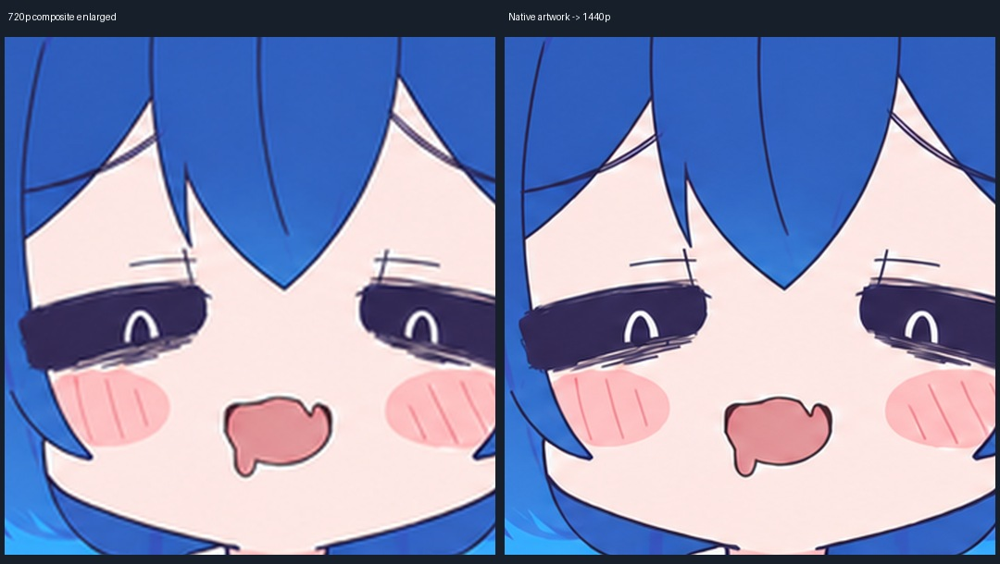

# 从原画重新合成1440p

## 720p发布版为什么仍显模糊

最早的渲染链为了对齐原片坐标，先把多数1671／1672 × 941的通过稿归一化到852 × 480，再把整帧放大到1280 × 720。第一步丢掉了线条细节，最后提高导出尺寸或码率无法找回它们。

1440p版本分开维护分析画布和实际渲染画布：

| 用途 | 分辨率与来源 |
|---|---|
| 事件、白框、紫色气泡、前景遮挡分析 | 保持852 × 480源坐标，沿用现有规则 |
| 人物完整画面 | 从原始941像素高稿直接采样到2556 × 1440，不经过480p颜色底图 |
| 独立图文 | 按相同源坐标等比注册到高清画布；原始480p图文不会凭空增加笔画细节 |
| 发布画面 | 左右各补2像素，输出2560 × 1440；H.264、24 fps、CRF 14、medium |

原画仍约941像素高，放到1440需要一次等比放大。改进来自保留已有原画的真实细节，不是重新生成了原生1440p原画。



左边为旧720p合成画面等比放大，右边为从原画重新合成的1440p画面；不加锐化。图中的图像是编码前检查点，成片采用CRF 14编码。

## 运行

先按[复现说明](reproduction.md)安装工作素材、核对源输入并构建时间线，再运行：

```bash
python tools/render_hd.py --label full-native-1440p --encode --checkpoints-explicit-only --checkpoint-frames 31,1632,2870,2940,3840,3845,5244
```

默认输出在 `project/renders/full-native-1440p/uno-ds-full-keyframes.mp4`。`--crf`和`--preset`可以覆盖编码参数。省略`--checkpoints-explicit-only`时，仍会保存原工程的全部事件检查点；高清PNG数量和体积都较大。

`render.py`保留720p默认输出。`render_hd.py`复用它的时间线和图文处理，通过`stage_image`、`draw_stage`、`blend_stage`和`output_raster`接入双画布。原画采样、形状绘制和贴图在高清画布执行；分析画布用来决定原有的排字和遮挡位置。

这次只改变合成和编码路径，保留现有动作取舍、通过稿和事件时刻。没有液化、局部人物变形、插帧或新生成姿态。

## 验证范围

25个指定源时刻完成高清画布检查，覆盖黑场、人物、幕布、嘴型／气泡、白框排字、黄锣遮挡、思考效果与尾卡淡出。人工查看了其中开场、白框和2:40气泡三张完整高清图。

新增画布接口后的720p路径，6个指定检查点的PNG与v1.0完整复跑结果逐字节相同。完整高清编码和实际解码结果见 `evidence/hd-render-validation.json`。
